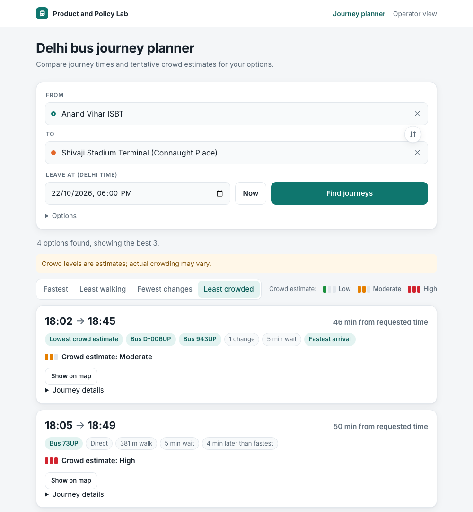

# Delhi crowdedness-aware bus journey planner

**Product and Policy Lab** · Delhi Transport Stack challenge, Problem 2

A journey planner for Delhi buses that shows, next to each option's travel time, an experimental ticket-derived pressure indicator, estimated from October 2026 mobile e-ticket records. Commuters can compare travel times with indicative estimates. Operators get a map of ticket-derived pressure.



## What it does

- **Plan a journey** between any two stops or places, with walking, waiting and bus times and up to three departures searched.
- **See a crowd estimate for each option**, colour-coded green (Low), orange (Moderate) or red (High), and **sort by least crowded**, so the trade-off between time and comfort is visible at a glance.
- **Operator view** (`/operators`): the route stretches and routes with the most mobile-ticket passengers per scheduled bus, by day type and time of day, on a map and in tables.


## Try it

You need Python 3.9+, the October ticket CSV and original static GTFS feed (see [Data and licences](#data-and-licences)). The reviewed stop mappings are included. No packages to install.

```sh
python3 -m unittest discover -s tests            # 110 tests
python3 src/cli.py --tickets data/input/October-Delhi.csv --gtfs data/input/gtfs \
  --review data-reference/reviewed-stop-mappings.csv --confirm-review \
  --start 2026-10-01 --end 2026-10-21 --output data/setup/training.json
python3 src/index_model.py --input data/setup/training.json --output data/setup/model.db --gtfs data/input/gtfs
python3 src/api.py --database data/setup/model.db --gtfs data/input/gtfs --port 8000
```

Open http://127.0.0.1:8000/. This quick setup uses a simplified built-in router. For full street-network walking and transfers, add OpenTripPlanner, or replay the recorded OTP responses with `--otp-recordings tests/fixtures/otp`. Step-by-step instructions are in [SETUP.md](SETUP.md).

## How it works

1. **Match tickets to the timetable.** Each ticket's route and stop names are matched to the GTFS stop sequence for that route, using exact names plus a reviewed list of corrections. Unmatched or ambiguous tickets are left out rather than guessed.
2. **Count passengers on each stretch.** A matched ticket adds its `passenger_count` to every stretch between its boarding and destination stops, in its boarding hour. This needs no bus number, which half the tickets lack.
3. **Divide by scheduled buses.** Totals per route, stretch, hour and day type (weekday, Saturday, Sunday) are divided by scheduled GTFS crossings over the training days. Days with buses but no tickets count as zero.
4. **Label stretches against their own hours.** A stretch at a given hour is *likely busier*, *typical* or *likely quieter* compared with the same stretch at other hours. Without enough evidence it says so rather than guessing. Sundays can use a wider three-hour window, marked as weaker evidence.
5. **Estimate each journey's crowding.** Stretch pressure is pooled over the hour and its neighbours, averaged per bus leg and weighted by ride time. It is placed in fixed Low / Moderate / High bands, with route-wide fallbacks when a stretch lacks data. This step assumes mobile-ticket use is similar across routes.

The full method, assumptions and API are in the [technical note](docs/submission-note.md) and [technical reference](docs/technical-reference.md).

## Results at a glance

| Check | Result | Source |
|---|---|---|
| Ticket sample behaves like commuter travel | Weekday peaks at 09:00 and 18:00; Saturday 74% and Sunday 47% of a weekday; weekday shape correlates 0.985–0.991 week to week; 9 of the 12 busiest peak routes reverse direction between morning and evening | [Known patterns](docs/known-patterns.md) |
| Tickets matched to the timetable (training, 1–21 Oct) | 916,872 of 1,672,406 (54.8%) | [Reproducibility check](docs/reproducibility-check.md) |
| Stretch labels on the held-out week (25–31 Oct), against labels from that week's tickets | Weekday 66.5%, Saturday 54.8%, Sunday 42.8% agreement | [Final ticket evaluation](docs/final-ticket-evaluation.md) |
| Stretch labels vs simpler predictors (22–24 Oct development days; reviewed model) | Weekday agreement: model 61.0%, route pattern 55.6%, citywide pattern 48.3%, always "typical" 35.1%. Opposite-end errors 4.5% vs 10.4% citywide | [Baseline comparison](docs/baseline-comparison.md) |
| Hour-order stability across rotating development weeks | 82.5–84.0% of weekday hour pairs ordered the same way | [Rotating weeks](docs/rotating-week-development.md) |
| Options with a journey crowd estimate (200 random searches) | 958 of 1,102 (86.9%). 687 of those use a route-wide fallback on at least one stretch | [Journey pressure evaluation](docs/journey-pressure-evaluation.md) |
| Rebuild from the same inputs | Training records and model index reproduced byte for byte | [Reproducibility check](docs/reproducibility-check.md) |

These agreement figures compare the model with **later ticket patterns**, not with people counted on buses.

## Limitations

- **The data covers mobile e-tickets only.** The organisers confirmed it is a subset of riders. Riders using other ticketing channels or passes may be missing, and its share of riders may differ by route and hour. Estimates are relative pressure, not passengers on board or seat availability.
- **Comparing routes assumes similar app use on every route.** The Low / Moderate / High labels, the least-crowded sort and the operator view rely on this, and it has not been verified.
- **Bus service is the timetable,** not buses that actually ran. Ticket time is treated as boarding time.
- **Thin evidence is filled from wider pools.** Many journey estimates use route-wide averages for some stretches; missing evidence is shown as *not enough data*, never as quiet.
- **No independent ground truth yet.** A [field check protocol](docs/field-study/protocol.md) is written, but no counts have been collected. The held-out week has now been used once and is not a fresh test for a revised model.
- **Routing is bounded.** The built-in fallback handles direct buses and same-stop changes with straight-line walking. OpenTripPlanner's search is not exhaustive either.

## Brief deliverables

| Brief asks for | Where |
|---|---|
| A rerunnable pipeline from ticket records to crowding estimates | `src/cli.py` → `src/index_model.py`; [SETUP.md](SETUP.md) |
| Crowding outputs that can be queried or shown on a map, by route, stretch and time of day | `GET /segments/signal`, `GET /operators/busiest`, the `/operators` map |
| A planner showing crowding next to each option and its travel time | `GET /journeys/mapped` and the screen at `/` |
| A short technical note: method, assumptions, least reliable areas | [docs/submission-note.md](docs/submission-note.md) |
| Checks against known patterns (peaks, busy corridors, weekday vs weekend) | [docs/known-patterns.md](docs/known-patterns.md) |
| Checks of how estimates hold up week to week | [Rotating weeks](docs/rotating-week-development.md), [final ticket evaluation](docs/final-ticket-evaluation.md) |

## Repository guide

| Path | Contents |
|---|---|
| `src/` | Pipeline (`cli.py`, `model.py`, `index_model.py`), model queries (`predict.py`), journey estimates (`journey_pressure.py`, `journey_choices.py`), routing (`otp_client.py`, `fallback_planner.py`, `journeys.py`), operator view (`operator_view.py`), API (`api.py`) |
| `web/` | Journey planner (`index.html`) and operator view (`operators.html`) |
| `scripts/` | Evaluation, diagnostics and report generators |
| `tests/` | Unit tests and recorded OpenTripPlanner responses (`tests/fixtures/otp`) |
| `docs/` | Technical note, evaluations and development record; start at [docs/README.md](docs/README.md) |
| `LICENSE` | MIT licence for the code and documentation |

## Data and licences

**Data source: [Delhi Transport Stack](https://delhi.transportstack.in)** (Delhi Transport Corporation and Department of Transport, Government of NCT of Delhi): October 2026 bus ticket records and the static GTFS feed. The applicable terms for the challenge ticket dataset and redistribution of derived outputs require confirmation with the organisers. It is provided "as is"; the estimates here are our own derived work, and the Delhi Transport Stack makes no representation about their accuracy.

The raw ticket CSV, GTFS feed, reviewed stop workbook, trained model and map graph are not in this repository. Accepted route-specific stop mappings are included in `data-reference/reviewed-stop-mappings.csv`. `tests/fixtures/otp` contains recorded routing responses that include aggregate figures derived from training tickets; no raw ticket records are included.

Code and documentation: [MIT licence](LICENSE). Street data © [OpenStreetMap contributors](https://www.openstreetmap.org/copyright). Place search by [Photon](https://photon.komoot.io).
