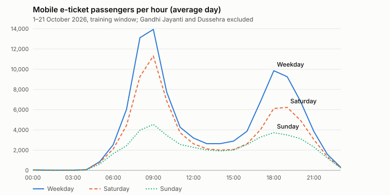

# Checks against known travel patterns

The brief asks for checks against familiar patterns: morning and evening peaks, busy corridors, and weekday versus weekend. This report checks the **raw mobile e-ticket sample** before any stop matching or modelling, so it does not depend on the reviewed workbook, GTFS or the model. It covers 1–21 October 2026, the training window; the reserved 25–31 October week is not read. Counts are mobile e-ticket passengers (`passenger_count`), which the organisers confirmed are a subset of riders, not all passengers.

Regenerate with `python3 scripts/known_patterns.py --tickets /path/to/October-Delhi.csv`.

## 1. Weekday morning and evening peaks

- Weekdays show the expected two commuter peaks: **09:00–10:00** in the morning and **18:00–19:00** in the evening.
- 40% of weekday passengers travel between 07:00 and 11:00, and 32% between 17:00 and 21:00.
- The morning peak hour carries 4.5× the average midday hour (11:00–16:00).

| Hour (IST) | Weekday | Saturday | Sunday |
|---|---:|---:|---:|
| 00:00 | 48 | 53 | 47 |
| 01:00 | 20 | 18 | 19 |
| 02:00 | 14 | 11 | 14 |
| 03:00 | 13 | 16 | 13 |
| 04:00 | 71 | 64 | 50 |
| 05:00 | 862 | 784 | 624 |
| 06:00 | 2,526 | 2,099 | 1,641 |
| 07:00 | 6,039 | 4,447 | 2,446 |
| 08:00 | 13,111 | 9,263 | 3,972 |
| 09:00 | 13,934 | 11,307 | 4,545 |
| 10:00 | 7,737 | 6,856 | 3,462 |
| 11:00 | 4,262 | 3,716 | 2,564 |
| 12:00 | 3,198 | 2,627 | 2,271 |
| 13:00 | 2,636 | 2,128 | 2,012 |
| 14:00 | 2,644 | 1,997 | 1,923 |
| 15:00 | 2,894 | 2,060 | 2,013 |
| 16:00 | 3,869 | 2,624 | 2,558 |
| 17:00 | 6,794 | 4,011 | 3,294 |
| 18:00 | 9,851 | 6,121 | 3,721 |
| 19:00 | 9,258 | 6,223 | 3,496 |
| 20:00 | 6,812 | 4,938 | 3,135 |
| 21:00 | 3,823 | 3,031 | 2,304 |
| 22:00 | 1,587 | 1,350 | 1,224 |
| 23:00 | 299 | 248 | 228 |

Values are average passengers per day in that hour.

## 2. Weekday versus weekend, and holidays

| Day type | Days | Average passengers per day | Relative to weekday |
|---|---:|---:|---:|
| Weekday (Mon–Fri) | 13 | 102,302 | 100% |
| Saturday | 3 | 75,993 | 74% |
| Sunday | 3 | 47,574 | 47% |
| Gandhi Jayanti (Fri 2 Oct, holiday) | 1 | 45,706 | 45% |
| Dussehra (Tue 20 Oct, holiday) | 1 | 56,102 | 55% |

Saturdays and Sundays carry fewer passengers and have flatter profiles without a sharp commuter peak, and both public holidays look like Sundays rather than weekdays. This supports modelling weekday, Saturday and Sunday separately; the current model treats holidays as ordinary weekdays (see the [model freeze](model-freeze.md)).

## 3. Week-to-week stability of the weekday shape

| Week starting | Weekdays | Passengers per day | Share 07–11 | Share 17–21 | Correlation of hourly shape with week of 5 Oct |
|---|---:|---:|---:|---:|---:|
| Mon 28 Sep | 1 | 101,171 | 42% | 30% | 0.991 |
| Mon 5 Oct | 5 | 103,577 | 39% | 32% | 1.000 |
| Mon 12 Oct | 5 | 106,009 | 41% | 32% | 0.991 |
| Mon 19 Oct | 2 | 90,414 | 38% | 34% | 0.985 |

A correlation near 1 means the hour-by-hour shape repeats from week to week. The first row is a partial week (only Thursday 1 October; Friday 2 October is Gandhi Jayanti), and the week of 19 October has two ordinary weekdays because of Dussehra on 20 October and the window ending on 21 October.

## 4. Busy corridors and tidal flow

Routes with the most weekday peak passengers (07–11 and 17–21 combined). Each route number covers both directions; UP and DOWN are its two directions. Commuter corridors should reverse direction between the morning and evening peaks.

| Route | Weekday peak passengers (3 weeks) | Morning: share UP | Evening: share UP |
|---|---:|---:|---:|
| 717A | 17,602 | 54% | 40% |
| 511A | 13,042 | 59% | 49% |
| 578 | 11,020 | 42% | 56% |
| 729 | 10,906 | 46% | 61% |
| 623 | 10,889 | 57% | 40% |
| 522 | 10,317 | 43% | 65% |
| 525STL | 10,278 | 54% | 41% |
| 717B | 10,193 | 60% | 31% |
| 433 | 10,137 | 35% | 60% |
| 764 | 9,529 | 46% | 48% |
| 774 | 9,493 | 47% | 49% |
| 534 | 9,439 | 49% | 48% |

9 of these 12 routes carry the majority of their passengers in opposite directions in the morning and evening peaks, the tidal pattern expected on commuter corridors. The shift is moderate, typically 10–30 percentage points, because both directions carry commuters on cross-city routes.

Most common weekday **morning destinations** and **evening origins**, as written on tickets. If commuting dominates, the places people travel to in the morning should reappear as the places they leave from in the evening.

| Rank | Morning destination (07–11) | Passengers | Evening origin (17–21) | Passengers |
|---:|---|---:|---|---:|
| 1 | Badarpur Border (T) | 5,839 | Saket Metro Station | 4,595 |
| 2 | Saket Metro Sation / Said-Ul-Ajaib | 5,706 | Said Ul Zeb Village | 4,434 |
| 3 | Kapashera Border | 5,163 | Kapashera Border | 2,624 |
| 4 | Mori Gate Terminal | 4,687 | Wazirpur Depot | 2,317 |
| 5 | Nehru Place Terminal | 4,063 | Mahipal Pur Village | 2,252 |
| 6 | Said Ul Zeb Village | 3,620 | Andrews Ganj | 2,204 |
| 7 | Krishi Bhawan | 3,446 | Mahipal Pur | 2,150 |
| 8 | Karol Bagh Metro Station | 3,283 | Rithala Metro Station | 1,819 |
| 9 | Aiims | 3,276 | Dhaula Kuan | 1,802 |
| 10 | Wazirpur Depot | 2,934 | Karol Bagh Metro Station | 1,778 |

4 of the top 10 morning destinations are also top 10 evening origins by exact name. Ticket spellings vary (for example "Saket Metro Sation / Said-Ul-Ajaib" and "Saket Metro Station"), so this undercounts the overlap.

## What this does and does not show

These checks show the ticket sample behaves like commuter travel, which supports using it for **relative** time-of-day and corridor comparisons. They do not show how many people are on a bus: the sample covers mobile e-tickets only, its share of riders can differ by route and time, and stop names here are as written on tickets, before matching. All timestamps in the window use offsets +05:30.
